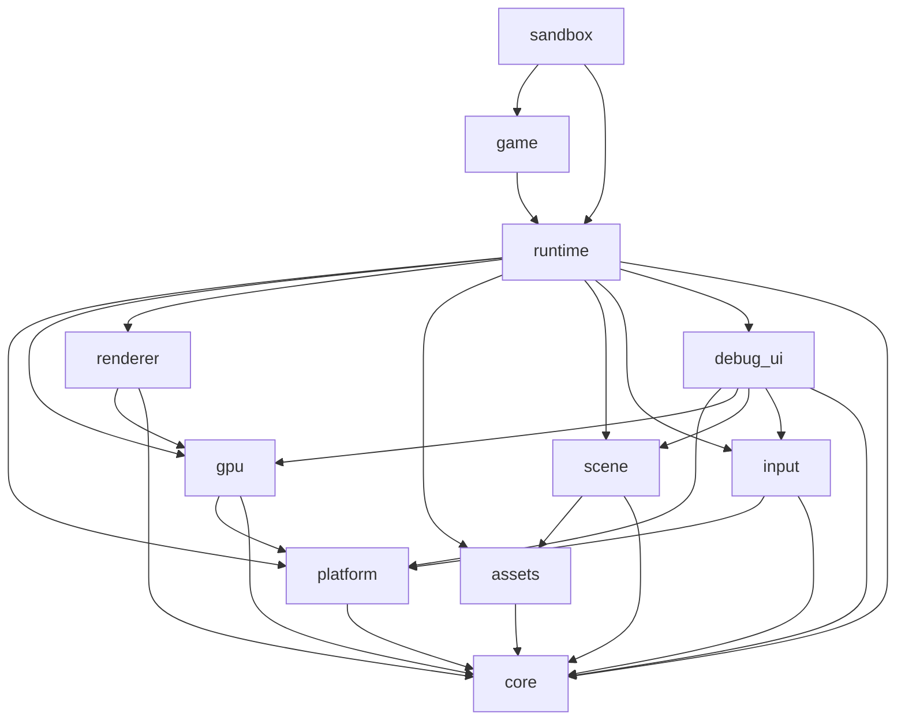

<!--
Décrit les frontières, les possessions et les échanges prévus pour Somnium.
Ce document est soumis à validation avant toute implémentation de la phase 0.
-->
# Architecture de Somnium

Statut : **proposition à valider**, 20 octobre 2026.

Ce dépôt commence par un jalon documentaire. Aucun module, build, test ni rendu
n'est encore implémenté. La validation de ce document et des
[ADR-0001](adr/0001-stack-dependances-licences.md) et
[ADR-0002](adr/0002-conventions.md) autorisera l'implémentation de la phase 0,
sans autoriser la phase 1 ni une fusion dans `main`.

## 1. Objectif et périmètre

Le consommateur de référence est un jeu C++ : personnage à la troisième personne,
sol et pièces, collisions AABB dans `game/`, portes articulées autour d'un pivot,
action `Interact`, clavier/souris et manette. Le MVP final charge une scène JSON
et affiche sa hiérarchie dans ImGui. Chaque capacité du moteur doit servir ce jeu.

La phase 0 fournit uniquement les fondations, l'outillage et une fenêtre vide.
Elle n'initialise aucun device GPU. Windows, Linux et macOS sont compilés et
testés ; aucune cible, API ni toolchain console n'est introduite.

Les conventions mathématiques, de mémoire, d'erreurs et de style sont décrites
dans l'ADR-0002. Leur traduction en constantes aura une seule autorité :
`engine/core/include/somnium/core/conventions.hpp`.

## 2. Points soumis à décision avant le code

Les recommandations suivantes ne sont **pas des dérogations acquises**.
Les contradictions et leurs sources sont détaillées dans l'ADR-0001.

| Référence | Point à trancher | Proposition |
| --- | --- | --- |
| D1 | `stb` n'a aucun tag, alors que seuls les tags de release sont autorisés hors shadercross. | Autoriser aussi un SHA complet pour `stb`, sans branche flottante. |
| D2 | Le backend officiel ImGui GPU inclut `SDL_gpu.h` ; celui de plateforme reçoit `SDL_Event`. La collecte par `platform` doit elle aussi voir ces événements. | Compiler les adaptateurs officiels dans les implémentations privées de `gpu` et `platform`, conditionnellement à l'UI. Autoriser `SDL_Event` dans ces seuls adaptateurs et dans `input`. `debug_ui` conserve l'UI et l'inspecteur, sans pointeurs SDL. |
| D3 | Le format MSL est du source compilé par SDL au chargement. | Conserver la sortie MSL de shadercross, puis produire un `.metallib` au build sur macOS. Le moteur charge exclusivement les formats préparés pour sa plateforme. |
| D4 | SDL GPU 3.4.18 ne fournit pas de requêtes de timestamps utilisables pour les zones GPU Tracy. | Garder Tracy CPU et mémoire, les marqueurs de debug GPU et les compteurs de commandes ; reporter les véritables durées GPU. Cela modifie explicitement le critère de sortie de phase 2. |
| D5 | La disponibilité des GPU nécessaires n'est pas établie sur les runners GitHub Actions. | Garder la matrice de compilation et tests ; exiger, pour les phases graphiques, des runners disposant effectivement de Vulkan, D3D12 et Metal. Leur fourniture reste à convenir ; un test ignoré ne valide pas un backend. |

Les précisions d'architecture ci-dessous sont également proposées à validation :
lecture de données injectée pour préserver le graphe, adaptateurs privés SDL,
transfert assets CPU vers renderer dans `runtime`, et gameplay statique appelé
par un contrat de `runtime`. Aucune de ces interfaces n'est encore codée.

## 3. Modules et visibilité CMake

Chaque module moteur aura une cible statique `somnium_<module>` et un alias
`somnium::<module>`. Ses en-têtes publics résident dans
`engine/<module>/include/somnium/<module>/`, ses implémentations dans `src/`,
ses tests doctest dans `tests/`.

La table décrit les dépendances **directes autorisées**. `PUBLIC` signifie que
des types de la dépendance appartiennent au contrat public ; `PRIVATE` réserve
les détails à l'implémentation. Les bibliothèques tierces sont précisées dans
l'ADR-0001.

| Module | Responsabilité | Somnium PUBLIC | Somnium PRIVATE |
| --- | --- | --- | --- |
| `core` | Logs, erreurs, handles, temps monotone, conventions, instrumentation, contrat de lecture de données | aucune | aucune |
| `platform` | Cycle de vie SDL, fenêtre, événements système, lecture et résolution des chemins | `core` | aucune |
| `gpu` | Enveloppe SDL GPU, ressources, commandes, frame et présentation | `core`, `platform` | aucune |
| `renderer` | Meshes et matériaux GPU, caméra de rendu, DrawList, passe forward | `core`, `gpu` | aucune |
| `assets` | Ressources CPU immuables, loaders, handles et états | `core` | aucune |
| `scene` | World/EnTT, composants, transforms, hiérarchie et JSON | `core`, `assets` | aucune |
| `input` | Traduction des événements en actions et axes | `core` | `platform` |
| `debug_ui` | Contexte ImGui, statistiques, inspecteur et édition | `core` | `platform`, `gpu`, `scene`, `input` |
| `runtime` | Engine, orchestration, simulation, extraction et correspondance assets/rendu | `core`, `scene`, `input` | `platform`, `gpu`, `renderer`, `assets`, `debug_ui` si activé |

`game/` produit une bibliothèque statique `somnium_game`, consommant `runtime`.
`sandbox/` contient l'exécutable et assemble le gameplay et `Engine`. C'est la
lecture retenue de « game/ et sandbox/ sont les seuls exécutables » : aucun
`main` dans le moteur ; un éventuel autre lanceur restera dans ces répertoires.
Le jeu est compilé dès la phase 0. Sa frontière dynamique n'est pas implémentée.

Le graphe moteur, lu dans le sens « dépend de », est :

Il n'existe notamment aucun arc `renderer -> scene`, `scene -> renderer`,
`scene -> gpu`, `assets -> platform` ou `runtime -> game`. `core` ne devient
pas un registre global de services.

Les includes ne sont pas ajoutés globalement à CMake. Les dépendances tierces
sont déclarées `SYSTEM`. Un contrôle de graphe et d'includes en CI complétera
`target_link_libraries` : la visibilité CMake seule n'empêche pas un include
relatif illicite ni la fuite d'un include transitif. Les en-têtes privés de
coopération ne sont pas installés. `SDL.h`, qui peut inclure d'autres
sous-systèmes, n'est pas utilisé comme raccourci pour contourner ces frontières.

## 4. Possession et durée de vie

`Engine` possède les sous-systèmes par valeur ou `std::unique_ptr`. Les
consommateurs reçoivent des références et des vues de durée de vie explicite.
Aucun service locator, singleton moteur ni `std::shared_ptr` n'est introduit.
La façade `Log` reste la seule exception d'état global mutable propre à Somnium.

Le lanceur possède l'instance de gameplay et la conserve pendant l'exécution
d'`Engine`. `runtime` définit le contrat de démarrage, pas fixe et arrêt ; `game`
le réalise. L'appel passe par ce contrat, jamais par un include de `game`.
Les références de scène et d'inputs sont empruntées pour l'appel. L'état moteur,
la registry et les ressources restent possédés par `Engine`.

En phase 0, `Engine` possède uniquement ce qu'il utilise : plateforme, fenêtre,
horloge et état de boucle. Les modules futurs peuvent avoir des cibles de build
sans instances factices ni fonctions vides.

À partir des phases suivantes, la création respecte les dépendances. À l'arrêt :
le gameplay cesse d'être appelé, les travaux GPU sont achevés, l'UI et ses
adaptateurs sont libérés, puis les ressources renderer, le device, la fenêtre
et SDL. Une initialisation partielle est nettoyée par RAII. Un destructeur ne
lève pas d'exception ; une fermeture récupérable qui doit être rapportée possède
une opération explicite retournant `Result`.

La simulation s'exécute sur un thread au MVP. Les contraintes documentées de SDL
sur le thread de fenêtre et d'événements sont respectées. Cela n'autorise pas
d'accès implicites depuis n'importe quel thread : les objets ont un propriétaire
et les emprunts ne sont pas partagés simultanément. Les dépendances peuvent
avoir leur propre état interne ou leurs threads, notamment Tracy ; elles ne
constituent pas une promesse de sûreté concurrente du moteur.

## 5. Contrats de données

Ces descriptions fixent la sémantique, sans promettre des signatures C++ déjà
implémentées.

| Contrat | Contenu et invariants | Propriétaire / emprunteur |
| --- | --- | --- |
| `Result<T>` | Alias de `tl::expected<T, Error>`, y compris `Result<void>` ; erreur typée et diagnostic possédé | retourné par valeur |
| `Handle<Tag>` | Index 32 bits et génération 32 bits ; types distincts par domaine, valeur nulle explicite | valeur copiée, validation par le propriétaire du stockage |
| Lecture de données | Identifiant logique et résultat de lecture d'octets possédés ; aucune notion de chemin OS dans les loaders | contrat minimal dans `core`, implémentation `platform`, injection par `runtime` |
| Asset CPU | Mesh, matériau ou image immuable après `Ready` ; références internes par handles | `AssetManager` ; emprunts bornés au traitement |
| `Transform` | Position, quaternion et échelle locaux ; matrice monde dérivée ; historique nécessaire à l'interpolation | composant plat dans le namespace `somnium`, stocké dans World |
| Hiérarchie | Parent et liens enfants utilisant les identités EnTT ; arbre acyclique, ordre de propagation défini | `scene` |
| Caméra extraite | Matrices vue/projection, position et paramètres utiles au rendu ; aucune référence à une entité | valeur dans la DrawList |
| Draw packet | Matrice monde interpolée, handle renderer de mesh, handle renderer de matériau, clé de tri | stockage réutilisable détenu par `runtime` |
| `DrawList` | Caméra et séquence contiguë de packets ; aucune registry, entité, ressource CPU empruntée ni pointeur SDL | `runtime` produit, `renderer` lit |
| État d'input | Actions tenues et transitions, axes, deltas et informations de périphérique utiles | `input` produit, gameplay consulte |
| Frame GPU | Ressources temporaires et commandes d'une frame ; fin par soumission ou abandon contrôlé | `gpu`, emprunts limités à la frame |

### Handles et assets

Un handle ne possède pas sa ressource. Le propriétaire teste l'index, l'occupation
et la génération avant de fournir un emprunt. Une destruction incrémente la
génération avant réutilisation du slot. Le retour à une ancienne génération est
interdit : un slot arrivé à saturation est retiré de la liste réutilisable.
Deux gestionnaires du même type ne s'échangent pas leurs handles.

Une demande d'asset retourne un handle et expose l'état `Unloaded`, `Loading`,
`Ready` ou `Failed`. Une demande irrecevable peut échouer par `Result` avant de
créer un handle ; une erreur de chargement d'une demande acceptée est conservée
avec l'état `Failed`. Au MVP, le chargement synchrone peut atteindre `Ready` ou
`Failed` avant le retour. Les appelants consultent néanmoins l'état.

Les erreurs et les données ne sont pas empruntées au-delà des garanties du
gestionnaire. L'éviction automatique, les jobs de chargement et le hot-reload
ne sont pas implémentés. La destruction contrôlée intervient à une frontière
où aucune extraction ni commande ne référence la ressource.

### Lecture et résolution des chemins

La dépendance `assets -> platform` serait contraire au graphe imposé.
Le contrat de lecture minimal est donc défini dans `core` ; `platform` le
réalise et `runtime` le fournit aux loaders. Les callbacks de lecture de cgltf
passent par ce contrat, y compris pour les buffers et images externes.

`platform` est seul responsable des racines de ressources, du dossier utilisateur
et des chemins physiques. Le moteur ne suppose pas que le répertoire courant
est celui du dépôt, ni qu'une ressource sera toujours un fichier de bureau.
Les données JSON et les shaders peuvent également être fournis comme octets.
Le futur format cuit remplacera la source et les loaders, sans changer les
handles ou les états ; aucun cuiseur ni système de montage n'est écrit au MVP.

### Frontière assets / rendu

`scene` conserve des handles d'assets CPU dans `MeshRenderer`. `renderer` possède
ses ressources de mesh et matériau, ainsi que leurs handles typés distincts.
`runtime` maintient la correspondance entre les deux domaines et adapte les
données CPU aux vues de création acceptées par `renderer`.

L'upload a lieu au chargement ou dans une étape de préparation explicitement
séparée, jamais implicitement au milieu du parcours chaud d'extraction. Un asset
non prêt est omis avec un diagnostic limité ; un shader obligatoire absent fait
échouer le démarrage graphique. Aucun chargement disque n'est déclenché par un
draw packet. Les matériaux de rendu regroupent données et handle de pipeline.

### Scène, persistance et interpolation

`World` possède directement une registry EnTT ; il ne masque pas EnTT derrière
une abstraction d'ECS. Les composants restent des structs plates dans
`somnium`. Les opérations de hiérarchie vérifient les cycles et les parents
invalides ; la destruction d'un parent doit appliquer une politique explicite,
précisée avec l'ADR-0006 avant l'implémentation de scène.

Le JSON porte `"version": 1` et des versions de composants. Les références
persistées utilisent des identités de scène et des identifiants logiques
d'assets, jamais les bits des handles runtime ni les valeurs brutes d'EnTT.
Les détails du schéma et la politique de migration seront soumis avec
l'ADR-0006 en phase 3.

Pour l'interpolation, les positions et échelles locales sont interpolées
linéairement, les quaternions par interpolation sphérique normalisée. Les
matrices monde sont ensuite reconstruites dans l'ordre parent-enfant. Mélanger
directement les coefficients de matrices monde ne convient pas aux pivots de
portes. Un nouvel objet, une téléportation ou un changement de parent réinitialise
son historique ; un objet détruit est exclu de l'extraction.

## 6. Événements et intégration ImGui proposée

Sous réserve de D2, `platform` collecte les événements SDL sur le thread requis.
Il traite le cycle de vie de la fenêtre, transmet les événements à l'adaptateur
officiel ImGui de plateforme et au traducteur privé d'`input`. Les consommateurs
publics reçoivent des états Somnium ; aucun `SDL_Event` ne traverse `runtime`,
`scene`, `renderer` ou `game`.

Le backend officiel `imgui_impl_sdl3` est compilé dans l'intégration privée
`platform`; `imgui_impl_sdlgpu3` dans l'intégration privée `gpu`. Les deux utilisent
la même bibliothèque tierce ImGui. Ils ne dépendent pas de `somnium_debug_ui`.
Les en-têtes privés de coopération exposent uniquement les emprunts nécessaires
au contexte et aux draw data ImGui, sans pointeurs SDL.

`debug_ui` possède le contexte, construit les widgets et l'inspecteur, et utilise
ces intégrations. Les accès à la fenêtre native sont privés à la coopération
`platform`/`gpu`, sans accesseur natif public. Les intégrations et le module UI
sont absents du build shipping.

Les événements sont toujours traités pour les relâchements, pertes de focus et
connexions de manette. La capture UI filtre ensuite les actions de gameplay,
sans perdre les transitions nécessaires pour éviter une touche bloquée.
Le détail du mapping et du routage est fixé dans l'ADR-0007.

## 7. Boucle et flux d'une frame

La boucle appartient à `runtime` ; le gameplay fournit ses mises à jour fixes.
L'horloge monotone de `core` exprime les durées en secondes.

1. Mesurer le temps réel et collecter les événements via `platform`.
2. Mettre à jour les états d'input et la capture de l'UI lorsqu'elles existent.
3. Ajouter un delta borné à l'accumulateur. Exécuter de zéro à plusieurs pas
   fixes : conserver l'état précédent, appliquer gameplay et systèmes de scène,
   puis propager les transforms courants.
4. Calculer `alpha = reste / pasFixe`, compris entre zéro inclus et un exclu.
5. Préparer les ressources nouvelles hors du parcours chaud, puis extraire la
   caméra et les packets interpolés dans une DrawList réutilisée.
6. Construire l'UI et obtenir une frame GPU. Préparer ses uploads avant les passes
   de rendu, comme l'exige le backend officiel ImGui.
7. Enregistrer la passe renderer, puis l'overlay UI via `gpu`.
8. Soumettre et présenter via `gpu`, puis marquer la frame CPU pour Tracy.

En phase 0, seules la collecte, l'horloge, la boucle bornée et les notifications
de gameplay utiles existent. Aucune DrawList ni opération GPU factice n'est
appelée. La cadence externe est régulée par une attente de plateforme pour
éviter une boucle active sans rendu.

Valeurs de départ proposées : pas fixe `1/60 s`, delta entrant plafonné à
`250 ms`, maximum de huit pas par itération. Après ce maximum, les pas entiers
excédentaires sont abandonnés et comptés, en conservant le reste fractionnaire.
Cette perte de temps de simulation est visible dans les diagnostics. Aucun
pas variable n'est substitué au pas fixe. Une reprise après suspension
réinitialise la mesure du temps plutôt que de rattraper toute la suspension.

Une action pressée entre deux pas fixes est mémorisée jusqu'au prochain pas et
consommée une seule fois. Un état tenu reste disponible pour chaque pas ;
les deltas souris ne sont pas répétés à chaque pas de rattrapage. Une frame sans
simulation ne perd pas les transitions. Les politiques détaillées seront testées
avec les inputs en phase 3.

Les conteneurs chauds sont réservés avant la scène, réutilisés et, lorsque
pertinent, de type `std::pmr`. Une croissance déclenche une étape documentée de
montée en charge. La DrawList est figée pendant sa consommation ; le stockage
reste valide jusqu'à la fin de l'enregistrement au MVP. Un futur thread de rendu
devra transférer ou doubler ce stockage et différer les libérations de ressources,
sans changer le contenu des packets.

## 8. Validation et séquencement

| Phase | Capacités ajoutées | Preuves exigées |
| --- | --- | --- |
| Jalon documentaire actuel | Architecture, stack et conventions proposées | Approbation explicite des trois documents et arbitrage des points bloquants |
| 0 | CMake/CPM, conventions codées, core, platform, boucle runtime, game et sandbox | Build sans warning, tests Result/handles/accumulateur, fenêtre locale et fermeture, matrice CI et sanitizers Linux verts |
| 1 | GPU, chaîne de shaders hors ligne, triangle, UI | Backends réellement exécutés, validation GPU, tests de ressources et shaders, ADR-0003/0004 |
| 2 | Assets CPU, rendu de mesh texturé, caméra via input | Modèle de référence, orientation et textures correctes, Tracy selon D4, ADR-0005 |
| 3 | World, hiérarchie, JSON, extraction, interpolation, mapping complet, gameplay de référence | Tests de hiérarchie/round-trip/extraction/interpolation, personnage bloqué par les murs, portes à pivot et inspecteur, ADR-0006/0007 |

Chaque module implémenté dispose de sa cible de tests doctest sous `tests/`.
Les tests n'instancient pas de GPU pour vérifier les contrats purement CPU.
Le test de fenêtre borné en CI ne remplace pas le contrôle visuel local ;
l'exécution ASan doit couvrir les chemins réellement exercés, sans prétendre
valider un backend non exécuté.

La CI future couvre configure, build, CTest et clang-format sur les trois OS,
plus ASan/UBSan sur Linux. Les presets sont `debug`, `release`, `profiling`
et `asan-ubsan` sur Linux/macOS. Le README sera livré avec l'implémentation
de phase 0 et donnera les commandes effectivement testées, y compris les
prérequis shadercross/DXC/SPIRV-Cross.

Le dépôt est initialement sans commit et sans branche distante. La branche de
travail est `phase/0-fondations` ; un rebase sur `main` est donc actuellement
impossible faute de commit de base. Aucun `main` artificiel ni tag de phase
n'est créé pour ce jalon. Le premier rattachement à `main`, absent à l'origine,
devra être convenu lors de la validation de phase ; un merge `--no-ff` a besoin
d'une branche de destination existante.

Les documents sont poussés pour revue avant le code. À ce stade il n'existe pas
de workflow CI : aucun statut vert n'est revendiqué. Après chaque étape de code,
le résultat de CI est lu avant de poursuivre. La phase reste ouverte jusqu'à
ses preuves de sortie et sa validation explicite.

## 9. Extensions réservées

| Extension hors MVP | Frontière préservée dès maintenant |
| --- | --- |
| Jobs et rendu sur un autre thread | Possession explicite, données extraites autonomes, aucune lecture de World par renderer |
| Arènes | Conteneurs `std::pmr` réutilisables ; aucune arène custom aujourd'hui |
| Render graph, ombres, PBR | Passe forward isolée, données de matériau et pipeline |
| Cuiseur, formats binaires, textures compressées, asynchrone | Lecture injectée, loaders par type, handles et états |
| Éditeur | Sérialisation par composant et inspecteur séparé |
| Hot-reload gameplay/shaders | Cible game distincte et chargement de shader centralisé ; aucune DLL ni surveillance de fichiers |
| Audio | Emplacement futur `engine/audio`, sous-système possédé par Engine |
| Tilemaps 2D | Emplacement futur `engine/tilemap`, données sans dépendance GPU |
| Réseau | Emplacement futur `engine/network`, câblage dans runtime |
| Consoles | Adaptateurs plateforme et GPU confinés, aucune supposition de fichiers desktop dans les loaders |

Les trois derniers emplacements sont réservés dans ce plan uniquement. Aucun
module vide audio/tilemap/network, système physique ni scripting n'est ajouté.
