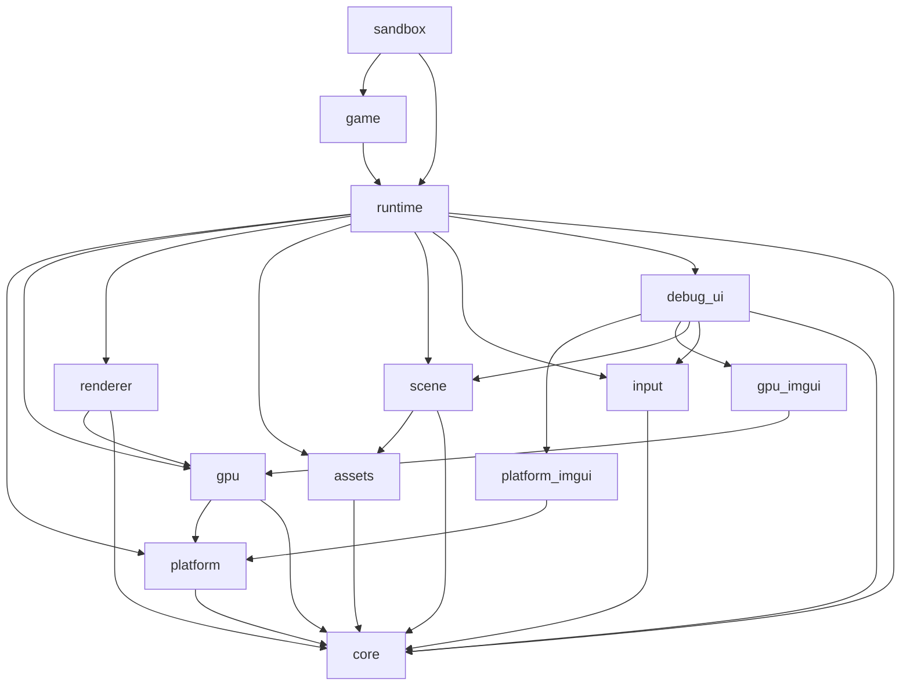

<!--
Décrit les frontières, les possessions et les échanges prévus pour Somnium.
Document validé ; distingue les contrats du MVP des capacités déjà implémentées.
-->
# Architecture de Somnium

Statut : **accepté**, 20 octobre 2026, avec les arbitrages D1 à D5 ci-dessous.

Les phases 0 à 2 sont validées, fusionnées `--no-ff` et taguées sur `main`.
La phase 2 se termine au tag `phase-2` (`bf0976a`, PR #4) ; `main` est la branche
par défaut. Infrastructure auto-hébergée intégrée ; [bilan et preuves](validation/phase-2/FIN_DE_PHASE.md).
`phase/3-scene` implémente les contrats acceptés des
[ADR-0007](adr/0007-scene-entites-serialisation.md) et
[ADR-0008](adr/0008-inputs-configurables.md). World et ses codecs sont décrits dans
[SCENE.md](SCENE.md) ; extraction/interpolation et preuve hors écran sont raccordées.
Le [point de contrôle intermédiaire](validation/phase-3/README.md) valide les
trois backends hors écran. Input configurable, rejeu, gameplay cible et inspecteur
sont maintenant implémentés ; résultats finaux et limites dans le
[bilan de phase 3](validation/phase-3/FIN_DE_PHASE.md).
Voir les
[ADR-0001](adr/0001-stack-dependances-licences.md) et
[ADR-0002](adr/0002-conventions.md).

## 1. Objectif et périmètre

Le consommateur de référence est un jeu C++ : personnage à la troisième personne,
sol et pièces, collisions AABB dans `game/`, portes articulées autour d'un pivot,
action `Interact`, clavier/souris et manette. Le MVP final charge une scène JSON
et affiche sa hiérarchie dans ImGui. Chaque capacité du moteur doit servir ce jeu.

Le sandbox charge `assets/scenes/courtyard.json` et `assets/input/courtyard.json`.
Le jeu pilote personnage, collisions, portes et caméra racine ; runtime extrait
la scène interpolée et renderer présente avec profondeur, lumière et ambiant.
L’inspecteur affiche la hiérarchie et applique les demandes de TRS au prochain pas.
Windows, Linux et macOS sont les seules plateformes ciblées.

Les conventions mathématiques, de mémoire, d'erreurs et de style sont décrites
dans l'ADR-0002. Leur traduction en constantes aura une seule autorité :
`engine/core/include/somnium/core/conventions.hpp`.

## 2. Arbitrages acceptés

| Référence | Décision |
| --- | --- |
| D1 | Toute dépendance sans release est épinglée par SHA complet, jamais par branche ; cette règle inclut stb et shadercross. |
| D2 | Les backends officiels sont compilés dans `somnium_platform_imgui` et `somnium_gpu_imgui`, cibles séparées activées uniquement par `SOMNIUM_ENABLE_DEBUG_UI=ON` et liées par `debug_ui`. Les sources de platform/gpu ne contiennent aucun include ImGui ni condition UI. SDL_Event reste dans platform (collecte, traduction neutre et intégration privée). Input ne contient aucun include SDL. Aucun type SDL public. |
| D3 | Le MVP charge le MSL produit hors ligne par shadercross. Le travail du driver est autorisé ; aucun compilateur HLSL dans le moteur. Le `.metallib` est reporté au cuiseur de phase 4 ; l'ADR-0003 le consigne comme prérequis de shipping macOS. |
| D4 | Pas de zones de durée GPU Tracy. Zones CPU, hooks mémoire, compteurs de draw calls/soumissions/uploads et marqueurs SDL visibles dans RenderDoc/PIX/Xcode. Critère de phase 2 amendé. |
| D5 | Test de rendu hors écran, relecture et comparaison à une référence avec tolérance. Depuis ADR-0006 : Vulkan/lavapipe Linux et D3D12/Vulkan Radeon Windows requis, Metal manuel best effort ; WARP n'est plus couvert. Sans device/couche sur un backend optionnel : résultat explicitement « non validé ». Une absence sur les deux runners requis fait échouer le job. Captures et journaux de validation joints à la PR. |

Les contrats de lecture dans `core`, réalisé par `platform` et injecté par
`runtime`, et de gameplay dans `runtime`, réalisé par `game` et assemblé dans
`sandbox`, sont acceptés. Les valeurs initiales de boucle sont acceptées.

`SOMNIUM_ENABLE_DEBUG_UI` est ON dans debug, release et profiling. Le preset
`shipping` le met à OFF. La licence doit être permissive sans copyleft pour le
code incorporé au moteur et à ses outils ; compilateurs et SDK de plateforme
sont hors de cette règle, y compris DXC utilisé comme outil.

## 3. Modules et visibilité CMake

Chaque module moteur ayant des sources réelles aura une cible statique `somnium_<module>` et un alias
`somnium::<module>`. Ses en-têtes publics résident dans
`engine/<module>/include/somnium/<module>/`, ses implémentations dans `src/`,
ses tests doctest dans `tests/`.

La table décrit les dépendances **directes autorisées**. `PUBLIC` signifie que
des types de la dépendance appartiennent au contrat public ; `PRIVATE` réserve
les détails à l'implémentation. Les bibliothèques tierces sont précisées dans
l'ADR-0001.

| Module | Responsabilité | Somnium PUBLIC | Somnium PRIVATE |
| --- | --- | --- | --- |
| `core` | Logs, erreurs, handles, temps monotone, conventions, instrumentation, contrat de lecture de données | aucune | aucune |
| `platform` | Cycle de vie SDL, fenêtre, événements système, lecture et résolution des chemins | `core` | aucune |
| `gpu` | Enveloppe SDL GPU, ressources, commandes, frame et présentation | `core`, `platform` | aucune |
| `renderer` | Meshes et matériaux GPU, caméra de rendu, DrawList, passe forward | `core`, `gpu` | aucune |
| `assets` | Ressources CPU immuables, loaders, handles et états | `core` | aucune |
| `scene` | World/EnTT, composants, transforms, hiérarchie et JSON | `core`, `assets` | aucune |
| `input` | Mapping CPU des événements neutres en actions et axes à pas fixe | `core` | aucune |
| `debug_ui` | Contexte ImGui, statistiques, inspecteur et édition | `core` | `platform_imgui`, `gpu_imgui`, `scene`, `input` |
| `platform_imgui` | Backend officiel SDL3 et coopération privée | aucune | `platform` |
| `gpu_imgui` | Backend officiel SDL GPU et coopération privée | aucune | `gpu` |
| `runtime` | Engine, orchestration, simulation, extraction et correspondance assets/rendu | `core`, `scene`, `input` | `platform`, `gpu`, `assets`, `renderer`, `debug_ui` si activé |

`game/` produit une bibliothèque statique `somnium_game`, consommant `runtime`.
`sandbox/` contient l'exécutable et assemble le gameplay et `Engine`. C'est la
lecture retenue de « game/ et sandbox/ sont les seuls exécutables » : aucun
`main` dans le moteur ; un éventuel autre lanceur restera dans ces répertoires.
Le jeu est compilé dès la phase 0. Sa frontière dynamique n'est pas implémentée.

Le contrat Gameplay emprunte World et les inputs ; aucun type renderer n’est
visible du jeu. Runtime → renderer est PRIVATE, vérifié au configure et par le
scanner d’architecture (en-têtes publics runtime et sources du jeu).

### Gameplay de référence

`SandboxGame` charge ses paramètres depuis les composants `game.Character`,
`game.AabbCollider`, `game.Door` et `game.FollowCamera` de `scenes/courtyard.json`.
Leurs codecs utilisent les lecteurs vérifiés et la seconde passe de références
de scene. Les identifiants d’actions/axes sont résolus dans `start`, jamais dans
le pas fixe. Le personnage se déplace à 3 unités/s, diagonale normalisée :
`MoveX/MoveZ` sont tournés par le yaw de FollowCamera, dans le plan horizontal.
L’orbite et le reset actualisent ce yaw avant le déplacement du même pas ; pitch
et zoom ne changent ni vitesse ni hauteur. Après résolution des collisions, la
caméra suit la nouvelle position. Le mesh enfant s’oriente dans la direction
demandée sans faire tourner son volume de collision.

Les AABB appartiennent uniquement à `game/`, sur des entités racines. La résolution
balaie X puis Z jusqu’au premier plan d’entrée, même pour un grand déplacement ;
elle conserve ainsi le glissement. Une téléportation dans un obstacle est corrigée
par la plus courte sortie horizontale, avec un nombre borné de passes et une
erreur explicite si les volumes restent incompatibles. Aucun module physique moteur.

Une porte conserve son AABB **fermée pendant toute l’ouverture**. `Interact`
sélectionne la porte fermée la plus proche dans sa portée ; le pivot tourne de
90° en une seconde (60 pas). Le collider disparaît des obstacles uniquement à
l’état `Open`. Le battant ouvert est décoratif : aucune collision rotative, fermeture
ou poussée de personnage au MVP. Cette règle est couverte par les tests CPU.

La caméra de suivi est une entité racine pilotée par le jeu, à distance 4–30 unités,
pitch 5–75°, avec orbite souris conditionnée au bouton maintenu et stick droit.
Scene fournit son interpolation comme pour toute entité. Runtime ne contient
ni comportement de caméra ni contenu du jeu. Les modèles originaux CC0 et leur
générateur reproductible sont recensés dans `assets/LICENSES.md`.

Le graphe moteur, lu dans le sens « dépend de », est :

Il n'existe notamment aucun arc `renderer -> scene`, `scene -> renderer`,
`scene -> gpu`, `assets -> platform` ou `runtime -> game`. `core` ne devient
pas un registre global de services.

Les includes ne sont pas ajoutés globalement à CMake. Les dépendances tierces
sont déclarées `SYSTEM`. `cmake/Architecture.cmake` rejette les liens directs
interdits et les dépendances privées exposées publiquement lors du configure.
Le contrôle d'includes `tools/check_architecture.py` vérifie en CI les frontières
natives et les dépendances entre en-têtes Somnium. Les en-têtes privés de
coopération ne sont pas installés. `SDL.h`, qui peut inclure d'autres
sous-systèmes, n'est pas utilisé comme raccourci pour contourner ces frontières.

## 4. Possession et durée de vie

`Engine` possède les sous-systèmes par valeur ou `std::unique_ptr`. Les
consommateurs reçoivent des références et des vues de durée de vie explicite.
Aucun service locator, singleton moteur ni `std::shared_ptr` n'est introduit.
La façade `Log` reste la seule exception d'état global mutable propre à Somnium.

Le lanceur possède l'instance de gameplay et la conserve pendant l'exécution
d'`Engine`. `runtime` définit le contrat de démarrage, pas fixe et arrêt ; `game`
le réalise. L'appel passe par ce contrat, jamais par un include de `game`.
Les références de scène et d'inputs sont empruntées pour l'appel. L'état moteur,
la registry et les ressources restent possédés par `Engine`.

`Engine` possède plateforme/fenêtre, lecteur, device, renderer, loader,
AssetManager, contexte d’assets, World, SceneRendering et sa préparation par
handle de Model, profondeur, overlay et boucle. Le jeu conserve les paramètres
d’orbite et modifie le Transform de la caméra racine. SceneRendering est détruit
avant World, World libère ses demandes avant AssetManager.
L'overlay et les ressources renderer sont détruits avant le device. Tous les modules ont
leurs répertoires et CMakeLists ; aucune cible sans sources réelles ni fonction
factice n’est créée.

À partir des phases suivantes, la création respecte les dépendances. À l'arrêt :
le gameplay cesse d'être appelé, les travaux GPU sont achevés, l'UI et ses
adaptateurs sont libérés, puis les ressources renderer, le device, la fenêtre
et SDL. Une initialisation partielle est nettoyée par RAII. Un destructeur ne
lève pas d'exception ; une fermeture récupérable qui doit être rapportée possède
une opération explicite retournant `Result`.

La simulation s'exécute sur un thread au MVP. Les contraintes documentées de SDL
sur le thread de fenêtre et d'événements sont respectées. Cela n'autorise pas
d'accès implicites depuis n'importe quel thread : les objets ont un propriétaire
et les emprunts ne sont pas partagés simultanément. Les dépendances peuvent
avoir leur propre état interne ou leurs threads, notamment Tracy ; elles ne
constituent pas une promesse de sûreté concurrente du moteur.

## 5. Contrats de données

Ces contrats décrivent les structures et possessions actuellement implémentées.

| Contrat | Contenu et invariants | Propriétaire / emprunteur |
| --- | --- | --- |
| `Result<T>` | Alias de `tl::expected<T, Error>`, y compris `Result<void>` ; erreur typée et diagnostic possédé | retourné par valeur |
| `Handle<Tag>` | Index 32 bits et génération 32 bits ; types distincts par domaine, valeur nulle explicite | valeur copiée, validation par le propriétaire du stockage |
| Lecture de données | Identifiant logique et résultat de lecture d'octets possédés ; aucune notion de chemin OS dans les loaders | contrat minimal dans `core`, implémentation `platform`, injection par `runtime` |
| Asset CPU | Mesh, matériau ou image immuable après `Ready` ; références internes par handles | `AssetManager` ; emprunts bornés au traitement |
| `Transform` | Position, quaternion et échelle locaux ; matrice monde dérivée ; historique nécessaire à l'interpolation | composant plat dans le namespace `somnium`, stocké dans World |
| Hiérarchie | Parent et liens enfants utilisant les identités EnTT ; arbre acyclique, ordre de propagation défini | `scene` |
| Caméra | Entité Camera + Transform interpolé ; vue inverse, projection RH_ZO, aspect de l’extent | World possède ; game pilote la pose ; runtime extrait |
| Draw packet | Matrice monde interpolée, handle renderer de mesh, handle renderer de matériau, clé de tri | stockage réutilisable détenu par `runtime` |
| `DrawList` | Séquence de mesh/matériau/monde ; `FrameData` porte séparément vue/projection/lumière/ambiant ; aucune registry ni donnée CPU empruntée | `runtime` produit, `renderer` lit |
| État d'input | Actions tenues et transitions, axes, deltas et informations de périphérique utiles | `input` produit, gameplay consulte |
| Frame GPU | Ressources temporaires et commandes d'une frame ; fin par soumission ou abandon contrôlé | `gpu`, emprunts limités à la frame |

### Handles et assets

Un handle ne possède pas sa ressource. Le propriétaire teste l'index, l'occupation
et la génération avant de fournir un emprunt. Une destruction incrémente la
génération avant réutilisation du slot. Le retour à une ancienne génération est
interdit : un slot arrivé à saturation est retiré de la liste réutilisable.
Deux gestionnaires du même type ne s'échangent pas leurs handles.

Une demande d'asset retourne un handle et expose l'état `Unloaded`, `Loading`,
`Ready` ou `Failed`. Une demande irrecevable peut échouer par `Result` avant de
créer un handle ; une erreur de chargement d'une demande acceptée est conservée
avec l'état `Failed`. Au MVP, le chargement synchrone peut atteindre `Ready` ou
`Failed` avant le retour. Les appelants consultent néanmoins l'état.

Les erreurs et les données ne sont pas empruntées au-delà des garanties du
gestionnaire. L'éviction automatique, les jobs de chargement et le hot-reload
ne sont pas implémentés. La destruction contrôlée intervient à une frontière
où aucune extraction ni commande ne référence la ressource.

### Lecture et résolution des chemins

La dépendance `assets -> platform` serait contraire au graphe imposé.
Le contrat de lecture minimal est donc défini dans `core` ; `platform` le
réalise et `runtime` le fournit aux loaders. Les callbacks de lecture de cgltf
passent par ce contrat, y compris pour les buffers et images externes.

`platform` est seul responsable des racines de ressources, du dossier utilisateur
et des chemins physiques. Le moteur ne suppose pas que le répertoire courant
est celui du dépôt, ni qu'une ressource sera toujours un fichier de bureau.
Les données JSON et les shaders peuvent également être fournis comme octets.
Le futur format cuit remplacera la source et les loaders, sans changer les
handles ou les états ; aucun cuiseur ni système de montage n'est écrit au MVP.

Le `FileReader` résout dans l’ordre `<exécutable>/assets` (shaders compilés), puis
`<dépôt>/assets` en mode DEVELOPMENT. Le preset shipping choisit COOKED : seule
la première racine existe, aucun repli vers le dépôt ni le répertoire courant.
CMake ne copie aucun asset source dans le build. Un package shipping doit apporter
la scène, le mapping et les modèles dans cette racine ; le test de conditionnement le prépare explicitement
dans un dossier temporaire extérieur au build, avant le cuiseur de phase 4. Son implémentation boucle sur les lectures partielles
jusqu'à complétion ; erreur, zéro progression prématuré ou taille supérieure à
256 MiB échouent explicitement. Les tests injectent un flux SDL fragmenté privé.

### Frontière assets / rendu

`scene` conserve des handles d'assets CPU dans `MeshRenderer`. `renderer` possède
ses ressources de mesh et matériau, ainsi que leurs handles typés distincts.
`runtime` maintient la correspondance entre les deux domaines et adapte les
données CPU aux vues de création acceptées par `renderer`.

L'upload a lieu au chargement ou dans une étape de préparation explicitement
séparée, jamais implicitement au milieu du parcours chaud d'extraction. Un asset
non prêt fait échouer le chargement transactionnel ; un shader obligatoire absent fait
échouer le démarrage graphique. Aucun chargement disque n'est déclenché par un
draw packet. Les matériaux de rendu regroupent données et handle de pipeline.

### Scène, persistance et interpolation

`World` possède directement une registry EnTT ; il ne masque pas EnTT derrière
une abstraction d'ECS. Les composants restent des structs plates dans
`somnium`. Les opérations de hiérarchie vérifient les cycles et les parents
invalides ; la destruction supprime le sous-arbre. Création, destruction et
reparentage sont immédiats, interdits pendant un parcours gardé.

Le JSON porte `"version": 1` et des versions de composants. Les références
persistées utilisent des identités de scène et des identifiants logiques
d'assets, jamais les bits des handles runtime ni les valeurs brutes d'EnTT.
Le schéma est décrit dans [SCENE.md](SCENE.md). Une version inconnue est une
erreur, sans migration implicite. Les codecs game partagent le résolveur d’IDs
de seconde passe ; un échec libère les demandes d’assets du World temporaire.

Pour l'interpolation, les positions et échelles locales sont interpolées
linéairement, les quaternions par interpolation sphérique normalisée. Les
matrices monde sont ensuite reconstruites dans l'ordre parent-enfant. Mélanger
directement les coefficients de matrices monde ne convient pas aux pivots de
portes. Un nouvel objet, une téléportation ou un changement de parent réinitialise
son historique ; un objet détruit est exclu de l'extraction.

## 6. Événements et intégration ImGui

`platform` collecte SDL, traite le cycle de fenêtre et traduit les périphériques
en `core::InputEvent` : enums Somnium, valeurs brutes, indice du prochain pas.
Sa coopération privée transmet les événements natifs à l’adaptateur ImGui.
La vue neutre est copiée par `input::Input::enqueue` avant le poll suivant.
Input dépend seulement de core ; ni include SDL ni SDL_Event dans ce module,
une interface publique ou les autres modules moteur.

Les cibles séparées `somnium_platform_imgui` et `somnium_gpu_imgui` compilent
respectivement les backends officiels `imgui_impl_sdl3` et `imgui_impl_sdlgpu3`.
Elles ont accès aux en-têtes privés de coopération de `platform` et `gpu` et
sont liées par `debug_ui`. Les sources de `platform` et `gpu` ne contiennent
aucun include ImGui ni `#if` lié à l’UI. Les cibles d’intégration n’existent
que si `SOMNIUM_ENABLE_DEBUG_UI=ON` ; leurs dépendances ne créent aucun cycle.

`debug_ui` possède le contexte, construit l’overlay et utilise les façades
d’intégration sans type SDL. Les pointeurs natifs demeurent dans la coopération
privée. La phase 1 initialise contexte, adaptateur plateforme puis adaptateur GPU.
Elle affiche FPS/temps moyen et compteurs draw calls/soumissions/uploads ;
l’inspecteur ajoute hiérarchie, sélection, TRS locaux et inputs en lecture seule. Les en-têtes publics des adaptateurs
ne contiennent aucun type SDL. Le scanner teste aussi les violations synthétiques
de D2 ; la CI shipping vérifie les cibles et la base de compilation.

Les événements de relâchement, perte de focus et déconnexion sont conservés.
Le mapping JSON est compilé avant start en IDs stables ; seules les valeurs et
les IDs circulent dans les pas fixes. Le panneau lit les états sans les consommer.
L’entrée en capture UI libère les actions concernées une seule fois, ignore les
nouveaux appuis/deltas et attend une pression fraîche après sortie. Le routage
ne perd ni ne rejoue les transitions pendant les frames sans pas ou le rattrapage.

Le rejeu JSON versionné est une source de `core::InputEvent` dans platform, livrée
à chaque frontière de pas. Il écarte les entrées physiques de gameplay et désactive
l’interaction avec l’inspecteur ; le cycle de fenêtre reste actif. Les scripts de
capture relisent la texture composée scène + UI à l’extent de la swapchain,
copiée vers celle-ci avant soumission, sans lecture du bureau ni injection système.
Windows interactif est requis, Linux utilise Xvfb ; Metal est
best effort sur un runner hébergé. Détails : [INPUT.md](INPUT.md).

## 7. Boucle et flux d'une frame

La boucle appartient à `runtime` ; le gameplay fournit ses mises à jour fixes.
L'horloge monotone de `core` exprime les durées en secondes.

Au démarrage, sandbox fournit le chemin de scène et la table de codecs (moteur
puis ajouts game). Runtime charge le World transactionnel via le lecteur et le
contexte d’assets, compile le mapping, appelle
`Gameplay::start(World&, const input::Configuration&)`, propage et prépare les ressources. `requestModel`, `camera()` et les réglages de rendu ont quitté le
contrat Gameplay ; modèle, lumière, ambiant et fond proviennent du JSON.

1. Platform collecte les événements natifs, transmet les événements à son adaptateur
   ImGui et produit les entrées neutres horodatées. Fermeture et suspension sont traitées.
2. Mesurer le delta ; debug_ui construit l’UI CPU depuis World et le dernier état
   d’input. Runtime applique la demande neutre de capture, puis met en file les
   événements différés du poll précédent et ceux du poll courant, dans cet ordre.
3. Pour chaque pas fixe : demander le rejeu éventuel à platform, `input.advance(tick)`,
   `World::beginStep`, appliquer les éditions UI par `World::teleport`, appeler
   `game.fixedUpdate(world,{seconds,tick,inputs})`, puis `World::propagate`.
   Seul game exécute déplacement, collisions, portes et caméra. Chaque transition
   et impulsion n’est consommée qu’une fois.
4. SceneRendering prépare les nouveaux handles de Model et retire les ressources
   inutilisées avant enregistrement ; matrices, draws et scratch renderer sont réservés.
5. Acquérir command buffer puis swapchain par `SDL_WaitAndAcquireGPUSwapchainTexture`,
   VSYNC, deux frames en vol. Le second poll met les entrées en attente jusqu’à la
   prochaine décision de capture UI. Une fermeture après acquisition soumet toujours.
6. Sans texture, soumettre sans rendu et attendre un événement. Au resize, recréer
   D32 à l’extent acquis et différer la libération précédente selon ADR-0004.
7. Interpoler les TRS locaux (lerp/slerp court), recomposer parent avant enfant,
   caméra et lumière comprises. Vue inverse, `perspectiveRH_ZO`, aspect acquis ;
   DrawList = monde interpolé × instance glTF. Buffers pmr réutilisés ; renderer
   ne voit jamais World. Un rejeu figé pour capture utilise alpha=1.
8. Préparer les uploads UI, enregistrer renderer puis l’UI ; textures sRGB → facteur
   × (Lambert + ambiant) linéaire → swapchain SDR_LINEAR. Soumettre, présenter et
   marquer la frame Tracy ; aucune attente artificielle.

Sur demande explicite de capture, après un premier frame figé stabilisant l’UI,
le frame suivant utilise une cible couleur possédée au format/extent acquis.
Renderer et intégration UI la partagent par la coopération privée GPU ; copie
vers swapchain avant soumission, relecture par transfer buffer après fence.
Le sandbox écrit RGBA8 sRGB et métadonnées ; aucun contenu de bureau n’est lu.
Cette attente GPU est limitée aux captures/outils, pas à la boucle interactive.

Le test cube garde un ambiant nul et son shader Lambert original : référence,
sondes et provenance inchangées. L’ambiant non nul sélectionne une variante de
shader avec uniforme de frame PS b2 ; le sandbox utilise 0,15. Chaque variante
possède les windings CCW/CW nécessaires aux instances de déterminant négatif.

Valeurs initiales acceptées : pas fixe `1/60 s`, delta entrant plafonné à
`250 ms`, maximum de huit pas par itération. Après ce maximum, les pas entiers
excédentaires sont abandonnés et comptés, en conservant le reste fractionnaire.
Cette perte de temps de simulation est visible dans les diagnostics. Aucun
pas variable n'est substitué au pas fixe. Une reprise après suspension
réinitialise la mesure du temps plutôt que de rattraper toute la suspension.

Une action pressée entre deux pas fixes est mémorisée jusqu'au prochain pas et
consommée une seule fois. Un état tenu reste disponible pour chaque pas ;
les deltas souris ne sont pas répétés à chaque pas de rattrapage. Une frame sans
simulation ne perd pas les transitions. Ces politiques sont testées sur CPU en
phase 3 ; une perte de focus réinitialise les états sans touche bloquée.

Les conteneurs chauds sont réservés avant la scène, réutilisés et, lorsque
pertinent, de type `std::pmr`. Une croissance déclenche une étape documentée de
montée en charge. Input et file différée réservent 128 événements, avec croissance
exceptionnelle journalisée. Le jeu réserve ses listes depuis la scène ; l’inspecteur
réutilise sa pile de hiérarchie. Les demandes d’édition allouent seulement lors
d’une interaction utilisateur, hors simulation ordinaire. La DrawList est figée pendant sa consommation ; le stockage
reste valide jusqu'à la fin de l'enregistrement au MVP. Un futur thread de rendu
devra transférer ou doubler ce stockage et différer les libérations de ressources,
sans changer le contenu des packets.

## 8. Validation et séquencement

| Phase | Capacités ajoutées | Preuves exigées |
| --- | --- | --- |
| Jalon documentaire | Architecture, stack et conventions | Accepté avec D1 à D5 |
| 0 | CMake/CPM, conventions codées, core, platform, boucle runtime, game et sandbox | Build sans warning, tests Result/handles/accumulateur, fenêtre locale et fermeture, matrice CI et sanitizers Linux verts |
| 1 | GPU, chaîne de shaders hors ligne, triangle, UI | Backends réellement exécutés, validation GPU, tests de ressources et shaders, ADR-0003/0004 |
| 2 | Assets CPU, rendu de mesh texturé, caméra via input | Modèle de référence, orientation et textures correctes, Tracy CPU/mémoire, compteurs et marqueurs GPU selon D4, ADR-0005 |
| 3 | World, hiérarchie, JSON, extraction, interpolation, mapping complet, gameplay de référence | Tests de hiérarchie/round-trip/extraction/interpolation, personnage bloqué par les murs, portes à pivot et inspecteur, ADR-0007/0008 |

Chaque module implémenté dispose de sa cible de tests doctest sous `tests/`.
L'[ADR-0006](adr/0006-ci-auto-hebergee.md) fixe la CI : Windows/Radeon et
Linux/WSL2/lavapipe requis, macOS manuel best effort, WARP non couvert. Les mêmes
scripts locaux/CI conservent caches et preuves sur disque, avec rétention de 14 jours.
Les tests n'instancient pas de GPU pour vérifier les contrats purement CPU.
Le test de fenêtre borné en CI ne remplace pas le contrôle visuel local ;
l'exécution ASan doit couvrir les chemins réellement exercés, sans prétendre
valider un backend non exécuté.

La CI automatique couvre configure, build, CTest et clang-format sur Windows/Linux,
en debug/release/shipping/profiling ; le workflow macOS manuel exécute les mêmes
presets. ASan/UBSan et clang-tidy 18 sont requis sur Linux. La fenêtre Linux est testée sur X11
avec Xvfb ; Wayland n'est pas exercé par ces jobs. Les presets sont `debug`,
`release`, `profiling`, `shipping` sans UI et `asan-ubsan` sur Linux/macOS.
Le README décrit les commandes de build et les prérequis
shadercross/DXC/SPIRV-Cross. Le CLI de shaders lié à DXC et sa validation
appartiennent à la phase 1 ; phase 0 compile l'archive shadercross hors moteur.

Le socle initial de `main` contient les trois documents acceptés, un README,
`.gitignore` et `.gitattributes` avec Git LFS. Il conserve le commit documentaire
antérieur. `phase/0-fondations` est avancée sur ce socle avant toute implémentation.
Les étapes cohérentes sont commitées et poussées, puis leur CI consultée.
La validation de fin de phase 0 autorise le rebase sur `main`, puis le merge
`--no-ff` et le tag `phase-0` après une nouvelle CI verte. La branche
`phase/1-gpu-shaders` part du commit de fusion. Les validations des phases
suivantes restent distinctes.

### Phase 1 — périmètre et compléments de revue

Point de contrôle du 21 octobre : le spike isolé sur
`feat/shader-toolchain-spike` prouve le CLI shadercross lié à DXC sur les trois OS.
Les [ADR-0003](adr/0003-chaine-shaders.md),
[ADR-0004](adr/0004-frame-synchronisation-gpu.md) et le
[plan CI](PHASE_1_CI.md) sont **acceptés** avec les ajustements du 21 octobre, avec détails dans
[SHADERS.md](SHADERS.md) et [GPU_VALIDATION.md](GPU_VALIDATION.md).
Les étapes a/b sont validées : génération CMake avec depfiles et manifeste
réfléchi, chargement via `ByteReader`, ressources GPU typées et test D5 sans fenêtre.
Les étapes c/d/e ajoutent :

- API `beginFrame` / `acquireSwapchain` / `recordPass` / `submitFrame` ;
  `finishFrame` annule seulement sans texture acquise. `renderOffscreen` compose
  cette API. `PipelineDescription` décrit formats couleur/profondeur, vertex
  layout et états ; D5 et triangle utilisent la même création de pipeline.
- Destruction pendant l'enregistrement : handle invalidé immédiatement, appel
  SDL de libération différé après soumission/annulation. La réutilisation du
  slot ne libère pas prématurément l'ancien objet ; tests CPU et D5 le vérifient.
- Présentation SDR/VSYNC à deux frames en vol, traitement resize/minimisation,
  fermeture après acquisition et suppression de l'attente artificielle.
- Deux intégrations ImGui séparées, pilotées par `debug_ui`, overlay de statistiques
  et vérification effective de l'exclusion UI du preset shipping.
- `Log` : seuil global Info, surcharge par catégorie exacte, niveau Off,
  `std::format` seulement après filtrage ; minimum macOS 13.3 accepté pour libc++
  Apple, MSL 2.3 explicite conservé. Aucun spdlog public. Tests de seuils,
  formatage et sortie réelle. Lecture partielle testée via un flux SDL privé.
- Actions GitHub épinglées par SHA, release sur les trois OS, clang-tidy 18 et
  analyse de toutes les unités Somnium ; archive historique shadercross optionnelle
  et OFF par défaut. Aucun configure ne lance le bootstrap des outils.

La référence PNG LFS commune, sa provenance, les seuils, la géométrie et les dix
sondes de D5 restent sous `engine/gpu/tests/`, inchangés. Le [protocole](GPU_VALIDATION.md)
et le [plan CI](PHASE_1_CI.md) distinguent rendu, compilation et présentation.
Lavapipe/Linux, Microsoft Basic Render Driver/Windows et Metal/macOS 15 passent
D5 avec zéro pixel différent et les couches de validation actives ; Vulkan et
D3D12 passent aussi sur la Radeon locale. NDC/UV/culling/profondeur sont confirmés dans l'ADR-0002.

Le runner **macos-15** reste nécessaire à la validation Metal : macOS 26 reproduit
un défaut de validation shader sur un programme SDK indépendant. L'horizon de
retrait annoncé et les conditions de migration figurent dans le plan CI.
Aucun diagnostic sans validation shader ne remplace la preuve exigée.
Les groupes de debug SDL suffisent ; aucun marqueur PIX spécifique n'est requis.

Les [pièces de présentation](validation/phase-1/README.md) montrent triangle,
overlay, resize et minimisation/restauration : Vulkan/D3D12 locaux, Metal en CI.
La capture Metal du runner est acceptée comme substitut local le 21 octobre 2026.
La validation finale exige la CI verte du SHA présenté dans la PR.
Un backend sans device/couche CI est « non validé » et exige la preuve locale
prévue par D5. La fusion `--no-ff` et le tag de phase restent soumis à l'accord
de fin de phase. ADR-0003/0004 tiennent chacun en une page ; leur ligne « Preuves »
recense uniquement les validations restantes.

## 9. Extensions réservées

Le [point de contrôle de phase 2](CUBE_VALIDATION.md) implémente déjà les extensions
GPU (indices, bindings, uniforms, formats sRGB), les loaders CPU et AssetManager,
puis renderer et l'adaptateur privé `runtime::ModelRendering`. Le renderer possède
meshes, textures et matériaux derrière des handles avec génération ; le runtime
produit la DrawList depuis les primitives et matrices monde importées. Sa capacité
de scratch est réservée au chargement ; aucun accroissement implicite dans record.
`FileReader` résout les racines ordonnées et ne replie que sur NotFound ; le preset
shipping sélectionne COOKED et exclut la racine du dépôt. Tests CPU et vérification
du graphe shipping accompagnent le cube hors écran et les captures interactives.
Le jalon cube est validé ; le triangle est remplacé, input et caméra orbitale
sont implémentés. `scene` et l’extraction interpolée sont maintenant raccordés. L'[ADR-0005](adr/0005-pipeline-assets.md) fixe ces contrats.

La phase 3 raccorde World/EnTT, codecs extensibles par game, IDs persistants,
interpolation locale, mappings compilés, rejeu et inspecteur. La cible jouable
est dans `game/` ; les composants AABB, portes, personnage et caméra se sérialisent
sans modifier les codecs moteur. La preuve analytique de scène et les tests CPU
précèdent le gameplay. Les phases suivantes attendent une nouvelle validation.

| Extension hors MVP | Frontière préservée dès maintenant |
| --- | --- |
| Jobs et rendu sur un autre thread | Possession explicite, données extraites autonomes, aucune lecture de World par renderer |
| Arènes | Conteneurs `std::pmr` réutilisables ; aucune arène custom aujourd'hui |
| Render graph, ombres, PBR | Passe forward isolée, données de matériau et pipeline |
| Cuiseur, formats binaires, textures compressées, asynchrone | Lecture injectée, loaders par type, handles et états |
| Éditeur | Sérialisation par composant et inspecteur séparé |
| Hot-reload gameplay/shaders | Cible game distincte et chargement de shader centralisé ; aucune DLL ni surveillance de fichiers |
| Contextes d'input et modes partageant une source | IDs résolus à la configuration ; une source physique, une destination au MVP, condition limitée aux deltas pendant une action maintenue (ADR-0008) |
| Audio | Emplacement futur `engine/audio`, sous-système possédé par Engine |
| Tilemaps 2D | Emplacement futur `engine/tilemap`, données sans dépendance GPU |
| Réseau | Emplacement futur `engine/network`, câblage dans runtime |
| Consoles | Adaptateurs plateforme et GPU confinés, aucune supposition de fichiers desktop dans les loaders |

Les trois derniers emplacements sont réservés dans ce plan uniquement. Aucun
module vide audio/tilemap/network, système physique ni scripting n'est ajouté.
